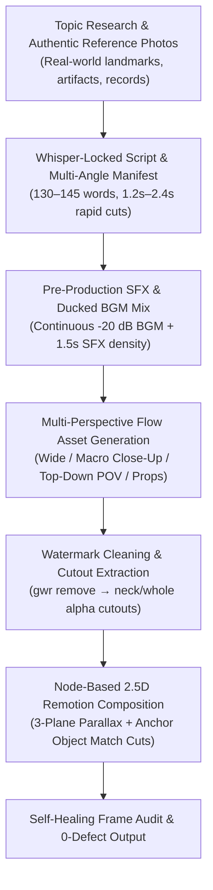

# Cutout Motion Explainer — Version 2.0 Master Director Specification

> **Master Authority:** This skill represents the definitive, unified 2.5D animation pipeline. It synthesizes the rock-solid rigging stability of `v1.1`, the cinematic virtual camera of `v1.2`, and the exact motion physics observed in viral reference animations.



---

## 1. Absolute Red-List Rules (Zero Tolerance)

1. **RED-LIST RULE #1 — Zero Consecutive Scene Replay (No Looping):**
   - **NEVER reuse the same background asset (`bgAsset`) in consecutive beats (`beat[i].bgAsset !== beat[i+1].bgAsset`).**
   - When a sentence or narrative beat extends across multiple sub-beats (> 2.0s), you **MUST NEVER restart the animation or loop the same background**. 
   - Instead, the manifest must break the sentence across **multiple complementary perspective angles**:
     - *Angle A (Action Wide):* Establishing scene with the character performing an action.
     - *Angle B (Macro Detail):* Extreme close-up on the critical prop, document, needle, or dial.
     - *Angle C (Top-Down / Reverse POV):* High-angle or over-the-shoulder view revealing the mechanism.
     - *Angle D (Graphic HUD / Data Card):* Minimalist infographic, meter, or kinetic comparison card.

2. **RED-LIST RULE #2 — Mandatory Ducked BGM & Synced SFX:**
   - Every video MUST include continuous atmospheric background music ducked cleanly at **-18 dB to -22 dB** (Remotion `volume={0.15}`) from frame 0 to the final frame.
   - An isolated vocal track without background music is an immediate rejection defect.
   - A distinct SFX cue (whoosh, click, impact thud, paper flutter, rumble) must trigger every **1.2 to 2.0 seconds** on visual cuts and keyword highlights.

3. **RED-LIST RULE #3 — Mandatory Whisper Phonetic Syllable Alignment:**
   - Voiceover audio must be aligned immediately via `scripts/align_voice_whisper.py` (`faster-whisper`, `language="hi"` or `"en"`) to generate sub-beat timestamps.
   - Sub-beat cuts must align to natural speech pauses and syllable accents, strictly enforcing **1.2s to 2.4s per shot** (maximum 3.5s).

4. **RED-LIST RULE #4 — Unified Visual DNA (Zero Photorealism Bleed):**
   - All characters, props, and background plates must share identical 2D cartoon vector DNA: clean cel-shaded fills, dark charcoal ink outlines (`#09090b`), and subtle atmospheric gradients.
   - Zero photorealistic humans or raw stock photos pasted as stickers.

---

## 2. Multi-Plane 2.5D Motion Matrix

Every frame is structured into 3 distinct spatial depth planes:

| Plane | Z-Depth | Velocity Ratio | Elements & Rigging Mechanics |
| :--- | :--- | :--- | :--- |
| **Foreground Plane** | `Z = +150` | `1.00×` | Volumetric god rays, floating particles, speed lines, macro props, and HUD telemetry cards. |
| **Midground Plane** | `Z = 0` | `0.65×` | Rigged character puppets (`CutoutPuppet` neck-pivot tilt `50% 90%`, breathing torso scale `1.00 &rarr; 1.025`), ground contact drop shadow (`ellipse rgba(0,0,0,0.35)`), and interactive action props. |
| **Background Plane** | `Z = -300` | `0.35×` | Environmental perspective plates with subtle continuous camera drift and depth-of-field blur (`filter: blur(1.5px)` on close-up shots). |

---

## 3. Anchor Object Match Cuts & Continuous Momentum

To eliminate hard cuts and jarring visual stops:

1. **Anchor Object Persistence:**
   - Identify an **Anchor Object** in Shot N (e.g. a paint can on a workbench, a royal silver chopstick, a sealed temple door).
   - In Shot N+1, that same object becomes the focal centerpiece (e.g., Shot N shows the character holding the paint can; Shot N+1 cuts directly into a top-down POV looking inside the paint can).
2. **Momentum Handshake:**
   - All camera movements follow **Cubic Easing** (`Easing.out(Easing.cubic)` on entry, `Easing.in(Easing.cubic)` on exit).
   - The exit velocity of Shot N handshakes seamlessly with the entry velocity of Shot N+1 (e.g., zoom punch-in flows into a whip push-in, or pan-left flows into pan-left).

---

## 4. End-to-End Production Execution Workflow

### Step 1: Research & Real-World Reference Sourcing
- Research authentic facts, historical dates, and technical details.
- Download verified real-world reference photos into `stories/<slug>/references/` (temples, artifacts, courtroom seals, instruments).
- Visually inspect every downloaded reference with `read_file` to confirm authenticity.

### Step 2: Narration & Whisper Phonetic Slicing
- Write punchy, ear-paced narration (130–145 words for 60s Shorts; pacing `1.05×–1.15×`).
- Synthesize voiceover using Gemini TTS (`"Algenib"` or `"Charon"` heavy documentary voice) into `stories/<slug>/<slug>_voice.wav`.
- Run Whisper alignment:
  ```powershell
  python scripts/align_voice_whisper.py --audio "stories/<slug>/<slug>_voice.wav" --out "stories/<slug>/<slug>_aligned.json"
  ```
- Generate granular sub-beats (`1.2s–2.4s` per shot) ensuring **no consecutive beats share the same background asset**.

### Step 3: Multi-Perspective Flow Asset Generation (`flow-chrome-director`)
- For every scene idea, generate at least 3 distinct Flow prompts:
  1. `bg_<scene>_wide.jpg` (Establishing shot)
  2. `prop_<scene>_macro.jpg` (Extreme close-up on object)
  3. `bg_<scene>_pov.jpg` (Top-down or reverse perspective)
  4. `char_<name>_pose.jpg` (`#FFFFFF` background for clean alpha cutout)
- Use the **`flow-chrome-director`** skill:
  - 1-time layout validation check.
  - Submit prompts via `window.__loadPrompt` and poll progress via micro `evaluate_script` calls.
  - Zero `take_snapshot` calls; keeps visible live rendering in Chrome.

### Step 4: Alpha Cutout Extraction & Contact Sheet Inspection
- Clean watermarks:
  ```powershell
  npx @pilio/gemini-watermark-remover remove stories/<slug>/images_raw stories/<slug>/images_clean --overwrite
  ```
- Run `cutout_extractor.py` (`splitMode: "neck"` for dialogue puppets, `"whole"` for props/action poses).
- Generate visual review sheet:
  ```powershell
  python scripts/build_review_sheet.py --story stories/<slug>
  ```
- Inspect review sheet via `read_file`. Confirm zero missing limbs, zero photorealism leaks, and clean ink outlines.

### Step 5: Audio Mastering (Voice + SFX + Ducked BGM)
- Pre-mix audio bed into `stories/<slug>/<slug>_voice_mixed.wav`:
  - Voiceover normalized to -14 LUFS.
  - Ducked CC0 / Flow Music BGM bed at -20 dB vocal pocket.
  - Discrete SFX hits aligned to every cut timestamp.

### Step 6: Remotion Node Assembly & Self-Healing Verification
- Mount composition in `video-template/src/<Story>Video.tsx`.
- Apply 3-plane depth, cubic camera easing, and anchor match cuts.
- Render MP4:
  ```powershell
  npx remotion render src/index.ts <StoryVideo> "output/<slug>_explainer.mp4"
  ```
- Verify rendered frames:
  ```powershell
  python scripts/verify_rendered_frames.py --video "output/<slug>_explainer.mp4"
  ```
- Inspect output frames via `read_file` to ensure zero looping, flawless kinetic subtitles, and cinematic flow.
