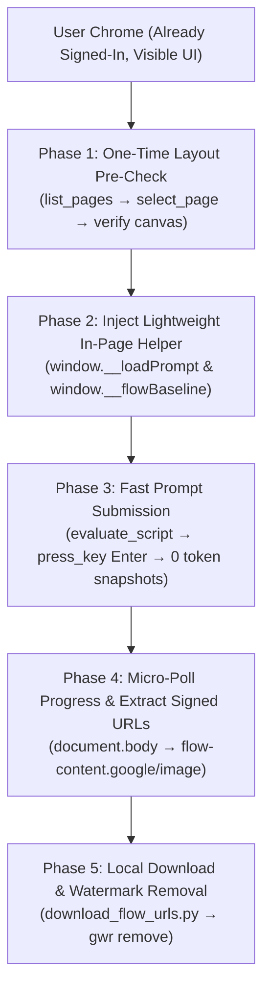

# Google Flow Chrome Director (High-Speed & Low-Token Automation)

> **Master Guide:** Based on the workspace standard [`FLOW_CHROME_MCP_GUIDE.md`](../../FLOW_CHROME_MCP_GUIDE.md).



---

## 1. Why Standard Automation Burns Tokens on Flow

- **The Problem:** Calling `take_snapshot` on every turn parses and returns hundreds of accessibility tree nodes for Google Flow's entire navigation bar, canvas, project drawers, and prompt panel. A single batch of 10 prompts burns over 30,000–50,000 tokens just on UI tree inspection.
- **The Solution:** Because Google Flow's UI layout does not change dynamically between prompts:
  1. Perform **one single pre-check** at the start of the session to confirm the canvas is ready and settings (`9:16` or `16:9`, count `x1`) are configured.
  2. Inject `window.__loadPrompt` into the browser session once.
  3. Drive all subsequent prompts purely through `evaluate_script` and native `press_key` (`Enter`). Each step consumes only **~50–80 tokens** instead of **3,000+ tokens**, accelerating generation by **5x** while letting the user watch the live rendering in real time.

---

## 2. Phase 1: One-Time Pre-Flight Check

Run once when attaching to the Flow tab:

```javascript
// Step 1: Attach via chrome-devtools
// list_pages -> select_page({ pageId: flowPageId })

// Step 2: One-time layout validation script
() => {
  const box = document.querySelector('[role="textbox"][aria-label="What do you want to create?"]');
  const genBtn = document.querySelector('button[aria-label="Start generation"]');
  const imgs = [...document.querySelectorAll('img')]
    .map(i => i.currentSrc || i.src)
    .filter(s => s && !s.startsWith('https://lh3.google.com/u/'));
  
  // Save pre-existing images so only newly generated ones are captured
  window.__flowBaseline = new Set(imgs);

  return {
    ready: !!box,
    genButtonExists: !!genBtn,
    baselineCount: window.__flowBaseline.size,
    url: window.location.href
  };
}
```

If `ready: true`, the layout is 100% verified. **Do not call `take_snapshot` again.**

---

## 3. Phase 2: Inject Reusable In-Page Prompt Runner

Inject this helper into the page session:

```javascript
() => {
  window.__loadPrompt = async (text) => {
    const clearBtn = document.querySelector('button[aria-label="Clear prompt"]');
    if (clearBtn) clearBtn.click();
    await new Promise(r => setTimeout(r, 80));

    const box = document.querySelector('[role="textbox"][aria-label="What do you want to create?"]');
    if (!box) return { ok: false, error: "textbox_not_found" };

    box.focus();
    document.execCommand("selectAll", false, null);
    document.execCommand("insertText", false, text);
    box.dispatchEvent(new InputEvent("input", { bubbles: true, inputType: "insertText", data: text }));

    await new Promise(r => setTimeout(r, 150));
    return { ok: true, len: box.innerText.trim().length };
  };
  return { installed: true };
}
```

---

## 4. Phase 3: Fast Execution Loop (Per Prompt)

For each prompt in the story manifest:

1. **Load Prompt (Micro-call):**
   ```json
   {
     "functionDeclaration": "() => window.__loadPrompt('Your prompt text here...')"
   }
   ```
2. **Trigger Generation:**
   Call `press_key({ pageId, key: "Enter" })`.
3. **Micro-Poll Status (Zero Snapshots):**
   Run every 4–6 seconds:
   ```javascript
   () => {
     const pct = document.body.innerText.match(/\d+%/g) || [];
     const newTiles = [...document.querySelectorAll('img')].filter(i => {
       const s = i.currentSrc || i.src || '';
       return s && s.includes('flow-content.google/image/') && !window.__flowBaseline.has(s);
     });
     return {
       generating: pct.length > 0,
       activePct: pct,
       newCount: newTiles.length
     };
   }
   ```
4. **Extract Signed Download URLs When Complete:**
   ```javascript
   () => {
     const imgs = [...document.querySelectorAll('img')].filter(i => {
       const s = i.currentSrc || i.src || '';
       return s && s.includes('flow-content.google/image/') && !window.__flowBaseline.has(s);
     });
     return imgs.map(i => i.currentSrc || i.src);
   }
   ```

---

## 5. Phase 4: Local Download, Watermark Removal & Inspection

1. Save signed URLs locally using `urllib.request.urlretrieve` into `stories/<slug>/images_raw/`.
2. Clean watermarks in 1 shell step:
   ```powershell
   npx @pilio/gemini-watermark-remover remove stories/<slug>/images_raw stories/<slug>/images_clean --overwrite
   ```
3. Run `cutout_extractor.py` and inspect cutouts via `read_file` before Remotion assembly.
