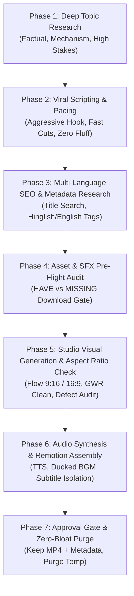

# Central Content Creation Protocol & Master SOP

> **Status:** Active Standard Operating Procedure (SOP)  
> **Applicability:** All Content Creation Skills (`stickman-explainer`, `cutout-motion-explainer`, and future formats)  
> **Target Formats:** YouTube Shorts (9:16) & Long-Form Documentaries (16:9)

---

## 1. Executive Protocol Overview

This document serves as the **single source of truth** for end-to-end content creation across all channels, languages, and animation formats. Any production initiated by a skill or agent must strictly conform to these standardized phases.

---

## 2. Phase 1: Deep Topic & Science Research (MANDATORY BEFORE SCRIPTING)

Never draft a script from superficial memory or generic summaries. Every topic must undergo active research.

1. **Active Web & Scientific Investigation:**
   - Query online sources, science papers, historical records, and credible explainers.
   - Extract the **core counter-intuitive mechanism** (e.g., *"Why do fingers prune? -> Active nervous system vasoconstriction for grip underwater, NOT soggy skin"*).
2. **Key Question Extraction:**
   - What is the common myth?
   - What is the startling real-world reality?
   - What are the physical/chemical/historical steps that cause it?
   - What is the high-stakes or humorous takeaway?
3. **Structured Brief Requirement:**
   - Synthesize a concise 3-point research summary into the topic scratchpad before proceeding to script writing.

---

## 3. Phase 2: Viral Scripting, Hook Architecture & Pacing

### The 3 Core Pacing Rules:
- **Rule 1: Aggressive Multi-Cut Hook (0.0s – 5.0s):**
  - First 3 to 5 seconds must have **3 to 4 rapid visual cuts (1.0s – 1.5s per scene)**.
  - Beat structure: `Visual Action -> Sudden Shock/Hazard -> Comical/Dread Reaction -> The Mystery Question`.
  - Zero logo animations, intro music builds, or "Hello guys" pleasantries.
- **Rule 2: Dynamic Audio-Driven Cut Formula:**
  - `Required Visual Scenes = ceil(Total Audio Duration / 2.5s)`.
  - *30s Short:* 12–14 scenes.
  - *45s Short:* 18–20 scenes.
  - *60s Short:* 24–26 scenes.
- **Rule 3: Hard Per-Scene Ceiling (Anti-Boredom Guarantee):**
  - No static image or visual angle may stay on screen for more than **2.8 seconds** (target: 1.5s – 2.4s).

---

## 4. Phase 3: Multi-Language SEO & Metadata Research

Never use generic or automated placeholder titles. Both English and Hindi (and any future languages) require distinct, platform-native SEO research tailored to how real users search.

### A. Pre-Metadata SEO Querying:
Before writing metadata, execute targeted search queries to identify:
1. High-velocity click-through rate (CTR) phrasing in that niche.
2. The exact search terms typed into YouTube's search bar.
3. Top-performing hashtag clusters.

### B. English Metadata Standard (`output/English/<slug>_metadata.txt`):
- **Title:** High-CTR, curiosity-gap title with relevant emoji (e.g., `Why Does Chopping Onions Make Us Cry? 🧅😭 (It's NOT What You Think!)`).
- **Description:** 2–3 hook-driven lines explaining the core mystery, followed by high-reach tags (`#Shorts #Facts #Science #Curiosity`).
- **Tags:** Highly relevant English search tags for global viewers.

### C. Hindi Metadata Standard (`output/Hindi/<slug>_metadata.txt`):
- **Title:** **Written in Hinglish (English letters with Hindi words)** — matches exact Indian mobile search habits (e.g., `Pyaj Kaatne Par Aankhon Se Aansu Kyu Aate Hain? 🧅😭`).
- **Description:** **Written in Hinglish** — 2–3 conversational lines in Roman-script Hindi explaining the hook, followed by trending tags:
  *(e.g., "Kya aapne kabhi socha hai, pyaj kaat te hi aankhon se aansu kyu aane lagte hain? Jaise hi knife chalta hai, chemical reaction se acid banta hai! #Shorts #FactsInHindi #DailyFunFacts #HindiFacts")*.
- **Tags (Hinglish-First Dual SEO):**
  - Natural conversational Hinglish queries: `pyaj katne se aansu kyu aate hai`, `daily fun facts hindi`, `hindi science facts`.
  - Plus targeted Devanagari equivalents if needed.
- **CRITICAL:** Never mix English titles/descriptions into Hindi metadata files.

---

## 5. Phase 4: Audio, Sound Design & SFX Pre-Flight Audit

1. **Pre-Production SFX Blueprint:**
   - Map every sound cue (`sfx_plan.json`) before generating visuals.
   - Audit `video-template/public/sfx/` (`[HAVE]` vs `[MISSING]`).
   - Download or generate all `[MISSING]` SFX before attempting render (zero 404s).
2. **Contextual SFX Layering:**
   - Physical diegetic SFX (water splashes, knife chops, metal clangs, cable snaps) matched directly to action frames.
   - Impact frames trigger camera vibration (`impactShake`).
3. **Background Music (BGM) Policy:**
   - Fresh royalty-free / CC0 music downloaded per story.
   - Ducked cleanly under dialogue (mixed at **30% to 40% volume**, max 47%) so speech is crisp and BGM adds energy without competing.

---

## 6. Phase 5: Visual Production & Screen Aspect Ratio Verification

1. **Google Flow Aspect Ratio Setting:**
   - **Vertical Shorts:** Explicitly locked to `9:16` vertical mobile viewport.
   - **Horizontal Documentaries:** Explicitly locked to `16:9` widescreen.
   - **No-Cropping Guarantee:** Prompts must specify centered compositions with ample border margins so elements never get cut off by phone UI overlays or top chapter cards.
2. **Watermark Cleaner:** Clean all raw images using `@pilio/gemini-watermark-remover` (`gwr remove ... --overwrite`).
3. **Anatomical Defect Audit:** Inspect every cleaned frame via `read_file` for missing facial features, spider limbs, or AI distortions before Remotion assembly.

---

## 7. Phase 6: Subtitle & Language Isolation in Remotion

- **Subtitles strictly match the audio track:**
  - English audio = English subtitles (clean boxed 3-word yellow highlight).
  - Hindi audio = Hindi Devanagari subtitles (with `'Noto Sans Devanagari'` font).
  - **Zero Cross-Talk:** Never render English subtitles over Hindi audio or vice-versa.
- **16:9 Long-Form Rule:** Full widescreen documentaries never burn in subtitles; they use clean visuals, chapter cards, and HUD overlays.

---

## 8. Phase 7: Approval Gate & Zero-Bloat Purge

- Keep working assets under `stories/<slug>/` during rendering so the user can review the output.
- **Only upon explicit user approval**, execute `purge_story_assets.py` to remove temporary images, raw voiceovers, and staging files while permanently preserving:
  1. `output/<Language>/<slug>_explainer.mp4`
  2. `output/<Language>/<slug>_metadata.txt`
  3. Shared reusable SFX in `video-template/public/sfx/`
