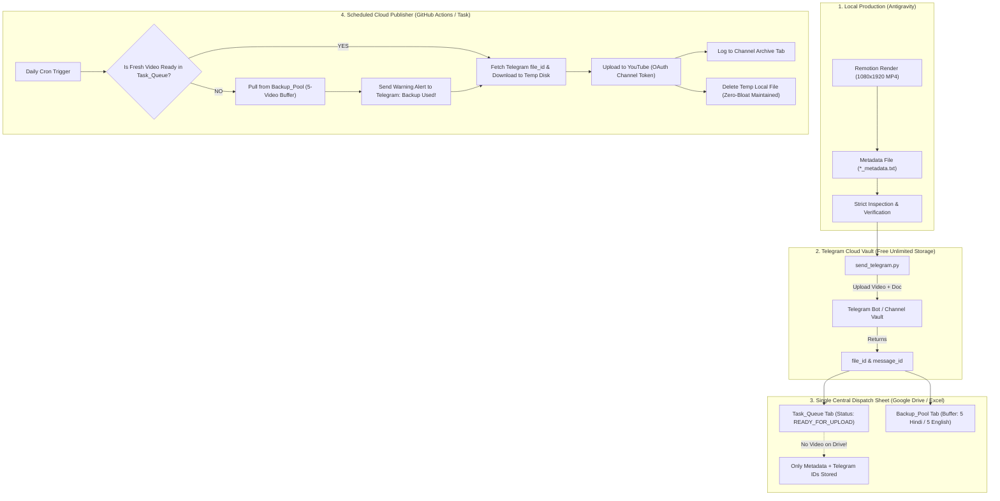

# Central Video Pipeline & Cloud Dispatcher Architecture (SOP)

This document is the **Single Source of Truth** for the entire automated video production, vaulting, tracking, and cloud publishing pipeline across this workspace. 

Any AI agent starting a new conversation in this workspace must read this document first to understand how videos are generated, backed up, tracked, and published without filling Google Drive storage.

---

## 1. System Architecture Overview



---

## 2. Why This Solves Google Drive Storage Exhaustion

| Metric / Aspect | Old Pipeline (Drive Direct) | New Pipeline (Telegram Vault + Sheet) |
| :--- | :--- | :--- |
| **Video Binaries on Drive** | Heavy MP4s (30–80 MB each) uploaded directly to Drive folders. | **ZERO video binaries on Drive.** Drive only holds the single lightweight Sheet. |
| **Drive 15 GB Quota** | Rapidly exhausted within 100–150 videos. | **Never fills up.** Drive usage stays < 5 MB indefinitely. |
| **Backup Redundancy** | Once purged locally and deleted from Drive, no backup existed. | **Permanent Telegram Vault.** Telegram retains all videos and metadata docs forever. |
| **Zero-Bloat Compliance** | High risk of data loss on local asset purge. | Local assets can be purged immediately after Telegram vault confirmation. |
| **Failover Buffer** | If no video was produced today, publishing stopped. | **5-video backlog pool** automatically deploys and pings Telegram with remaining count. |

---

## 3. Configuration & Credentials (`.env`)

All credentials for the pipeline reside in a single file:
**`c:\Users\susho\Downloads\flow antigravity\.env`**

### Required Keys:
```ini
# --- TELEGRAM MEDIA VAULT ---
TELEGRAM_BOT_TOKEN=your_bot_token_from_botfather
TELEGRAM_CHAT_ID=your_chat_id_or_channel_id

# --- GOOGLE DRIVE & SHEETS TRACKER ---
GOOGLE_SERVICE_ACCOUNT_JSON={"type": "service_account", ...}

# --- YOUTUBE PUBLISHING TOKENS ---
YOUTUBE_TOKEN_HINDI={"token": "...", "refresh_token": "...", ...}
YOUTUBE_TOKEN_ENGLISH={"token": "...", "refresh_token": "...", ...}
```

> [!IMPORTANT]
> **User Setup Required:** You only need to create a bot via [@BotFather](https://t.me/BotFather) on Telegram, get your `TELEGRAM_BOT_TOKEN`, add the bot to your private storage channel (or send `/start` in your private DM with the bot), and save the `TELEGRAM_BOT_TOKEN` and `TELEGRAM_CHAT_ID` inside `c:\Users\susho\Downloads\flow antigravity\.env`. Everything else is handled automatically by the scripts.

---

## 4. Pipeline Stages & Detailed Workflow

### Stage 1: Video Production & Zero-Bloat Rules
1. Video is generated using the appropriate skill (`cutout-motion-explainer` for 2.5D documentary/hybrid or `stickman-explainer` for stickman videos).
2. The final rendered MP4 is placed in `output/<Language>/<slug>_short.mp4` along with `<slug>_short_metadata.txt`.
3. Quality & audio sync are inspected visually and audited with `ffprobe` (< 50 MB limit).
4. Do **NOT** purge local intermediate files until the video is uploaded to the Telegram Vault and confirmed.

### Stage 2: Telegram Vaulting & ID Capture
1. Run `python scripts/send_telegram.py --video output/<Language>/<slug>_short.mp4 --meta output/<Language>/<slug>_short_metadata.txt --vault`.
2. The script uploads the video as a Telegram video stream (for mobile playback) and uploads the companion metadata file as a document.
3. The Telegram API returns:
   - `file_id`: Unique persistent identifier to re-download the video anytime.
   - `message_id`: Exact message identifier in the vault channel.
   - `file_size`: Confirmed byte count.
4. Once vault upload succeeds, run `purge_story_assets.py --story <slug>` to keep the local disk at zero bloat.

### Stage 3: Central Sheet Dispatcher (Drive Tracker)
The master Google Sheet / Excel file located on Drive contains three core tabs:

#### 1. `Task_Queue` (Daily Publishing Schedule)
| Scheduled_Date | Channel | Topic | Title | Telegram_File_ID | Telegram_Msg_ID | Status | Notes |
| :--- | :--- | :--- | :--- | :--- | :--- | :--- | :--- |
| 2026-11-12 | ENGLISH | Hakari Domain | Why Nobody Can Beat Hakari | `BAACAg...` | `1042` | `READY_FOR_UPLOAD` | Video in TG Vault |

#### 2. `Backup_Pool` (5-Video Safety Backlog)
Maintains a minimum buffer of **5 Hindi** and **5 English** pre-approved evergreen videos:
| Pool_ID | Channel | Title | Telegram_File_ID | Telegram_Msg_ID | Status | Date_Added |
| :--- | :--- | :--- | :--- | :--- | :--- | :--- |
| ENG-01 | ENGLISH | Mariana Vents | Mariana Trench Secrets | `BAACAg...` | `1030` | `STANDBY` | 2026-11-10 |
| ENG-02 | ENGLISH | Hakari Domain | Idle Death Gamble Rules | `BAACAg...` | `1042` | `STANDBY` | 2026-11-11 |

#### 3. `Published_Archive`
Logs successfully published YouTube videos with live stats:
`[Date_Published, Channel, Title, YouTube_URL, Video_ID, Telegram_File_ID, Status]`

---

## 5. Scheduled Cloud Dispatcher & 5-Video Backlog Failover

When the daily scheduled cron worker triggers (e.g., at 10:00 AM UTC):

1. **Check Fresh Queue:** The dispatcher inspects `Task_Queue` for any task scheduled for today with `Status == 'READY_FOR_UPLOAD'`.
2. **Standard Path (Fresh Video Exists):**
   - Retrieves `Telegram_File_ID` from the Sheet.
   - Uses Telegram Bot API `getFile` to download the MP4 into temporary memory/disk (`/tmp/video.mp4`).
   - Uploads to YouTube via Google YouTube Data API v3.
   - Moves row to `Published_Archive` with YouTube URL.
   - Removes `/tmp/video.mp4`.
3. **Failover Path (No Fresh Video Produced):**
   - The dispatcher detects that no fresh video is scheduled or ready.
   - It queries `Backup_Pool` for the oldest available video matching the target channel (`Status == 'STANDBY'`).
   - Downloads the backup video from Telegram via its `Telegram_File_ID`.
   - Publishes the backup to YouTube.
   - Marks the backup row as `USED` in `Backup_Pool`.
   - Counts remaining backups (`rem = count('STANDBY')`).
   - **Sends an Urgent Alert to Telegram:**
     ```text
     ⚠️ AUTOMATION NOTICE: NO NEW VIDEO FOUND TODAY
     -------------------------------------------------
     Channel: How Did That Happen (English)
     Action: Published backup video from vault:
     Title: 'Why Nobody Can Beat Hakari's Domain Expansion'
     YouTube URL: https://youtu.be/...
     
     🚨 Backlog Status: Only 3 backup videos remaining!
     Please produce new videos to refill the 5-video safety buffer.
     ```

---

## 6. How New AI Sessions Must Operate

When a user prompts a new conversation with: *"Create a new short about X"* or *"Upload yesterday's video"*:
1. Read this file ([PIPELINE_ARCHITECTURE.md](file:///c:/Users/susho/Downloads/flow%20antigravity/PIPELINE_ARCHITECTURE.md)).
2. Produce the video following the appropriate skill (`cutout-motion-explainer` or `stickman-explainer`).
3. Vault the video and metadata directly to Telegram using `scripts/send_telegram.py`.
4. Register the new video's Telegram `file_id` into the tracking Sheet.
5. If the `Backup_Pool` has fewer than 5 videos, register the video to `Backup_Pool` instead of `Task_Queue` (or ask the user if it is meant for today's release vs. the safety buffer).
6. Run `purge_story_assets.py --story <slug>` only after the user reviews the output and the Telegram vault upload is confirmed.
