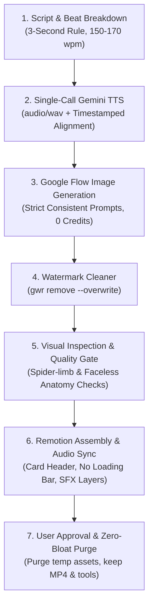

# Master Architecture & Knowledge Blueprint: Automated Stickman Video System

> **Author:** Antigravity Engineering & Production Agent  
> **Status:** Production Verified (2 Explainer Videos Rendered & Approved)  
> **Skill Package:** `stickman-explainer` (Globally installed in `~/.gemini/config/skills/stickman-explainer`)

---

## 1. Executive Summary & Production Formula

This document codifies the entire architecture, creative rules, script templates, automation code, quality control gates, and multi-language YouTube scaling roadmap for producing viral stickman explainer videos (9:16 Shorts and 16:9 Long-Form).

### Why the 2D Stickman Comic-Panel Format Dominates:
1. **The 2–3 Second Visual Rule:** Retention algorithms on YouTube Shorts and Instagram Reels prioritize frequent visual frame shifts over complex frame-by-frame rigging.
2. **High-Contrast Character Design:** Minimalist white capsule head, bold dot eyes, expressive line mouth, and pill-shaped torso pop vividly on mobile OLED screens.
3. **Zero Credit Overhead in Flow:** Standard 2D image tiles cost **0 Google Flow credits**, allowing unlimited scene generation on the free tier.
4. **Single-Call Voiceover Synthesis:** Complete 30s to 90s scripts synthesized in one Gemini TTS API call with millisecond-exact word/beat timestamps.

---

## 2. End-to-End Production Workflow (The 7 Pillars)



---

## 3. Pillar Breakdown & Core Code Patterns

### Pillar 1: Scripting & Chapter Cards
- **Voice Pacing:** 2.5 to 3.5 words per second (150–170 wpm).
- **No Top Loading Bar:** Clean UI; avoids distracting top progress bars.
- **Top Chapter Card:** Two high-contrast lines (`28px` bold category tag + `46px` primary title in rounded container).
- **Sound Effects:** Layered into three tiers:
  1. *Pacing SFX:* Subtle whooshes and pop sounds on panel cuts.
  2. *Diegetic Object SFX:* Animal bleats/snorts, tractor engine chugs, water splashes, tool clinks.
  3. *Audio Ducking:* Background music compressed by -12dB under speech.

### Pillar 2: Single-Call Gemini TTS Script
Located at `scripts/generate_gemini_story_tts.py`:
- Calls the Gemini API with structured voice prompt.
- Extracts raw PCM24/WAV bytes and saves local audio file.
- Generates exact millisecond timestamps per narrative beat.

### Pillar 3: Google Flow Prompting Formula
To guarantee consistent stickman anatomy without deformed or faceless heads:
```text
Single minimalist 2D cartoon stickman with big round white head, two clear black dot eyes and <EXPRESSION> mouth, clean white rounded torso pill and black stick limbs, <ACTION/HOLDING ITEM>, simple flat vector background showing <SCENE>, bold clean lineart, vibrant saturated colors, YouTube explainer cartoon style.
```

### Pillar 4: Watermark Removal
Automated via CLI in PowerShell:
```powershell
python -m gwr remove "scene_XX.jpg" "scene_XX.jpg" --overwrite
```

### Pillar 5: Mandatory Visual Defect Inspection
Before assembly, every frame is audited against:
- **Spider Limbs:** Tangled extra arms or multi-jointed legs.
- **Faceless Blank Heads:** Missed facial features or wireframe heads.
- **Aspect Ratio:** Verified 9:16 (Shorts) or 16:9 (Long-Form).

### Pillar 6: Remotion Dynamic Motion Engine
Static panels are transformed into dynamic comic motion using Remotion math:
- **Impact Shake (Sinusoidal Dampening):**
  ```tsx
  const shake = Math.sin(frame * 1.5) * Math.max(0, 10 - frame * 0.6);
  // transform: `translate(${shake}px, ${shake * 0.5}px)`
  ```
- **Cinematic Parallax Drift:** Slow `scale` from 1.0 to 1.08 over the beat duration with gentle horizontal pan.

### Pillar 7: Post-Approval Zero-Bloat Asset Purge
Once the user approves the final MP4 render:
- `purge_story_assets.py --story <story_name>` deletes raw and clean JPEG tiles, working voiceover WAVs, and temporary webpack bundles.
- Preserves only the final rendered `.mp4` video and the reusable Python/Remotion scripts.

---

## 4. Multi-Language YouTube Expansion Architecture

### Dual-Account Google Drive Structure
When using an automation Gmail account linked to a main personal Gmail:
- **Ownership:** Main Account creates and owns the master folder:
  `Google Drive / AI Video Studio /`
- **Sharing:** Main Account shares the folder with the Automation Account with `Editor` privileges.
- **Storage Quota:** All uploaded video files consume quota **only from the owning Main Account**, keeping the automation account completely free of storage limits.

### Google Sheets Tracking Schema
A single master spreadsheet tracks the end-to-end publishing pipeline:

| Video ID | Topic / Hook | Target Language | Status | Flow Prompts Status | Voiceover File | Rendered MP4 | YouTube URL |
| :--- | :--- | :--- | :--- | :--- | :--- | :--- | :--- |
| `STK-001` | History of Toothbrushing | English | Published | Approved | `toothbrush.wav` | `output/tooth_brushing.mp4` | `youtu.be/...` |
| `STK-002` | History of Farming | English | Published | Approved | `farming.wav` | `output/history_of_farming.mp4` | `youtu.be/...` |
| `STK-003` | History of Farming | Spanish | Queued | Auto-Translated | Pending | Pending | - |

---

## 5. Summary of Permanent Files on Your Machine

1. **Skill Definition:**
   `c:\Users\susho\Downloads\flow antigravity\.agents\skills\stickman-explainer\SKILL.md`
2. **Global Skill Copy:**
   `C:\Users\susho\.gemini\config\skills\stickman-explainer\SKILL.md`
3. **Approved Production Videos:**
   - [tooth_brushing_explainer.mp4](file:///c:/Users/susho/Downloads/flow%20antigravity/output/tooth_brushing_explainer.mp4)
   - [history_of_farming_explainer.mp4](file:///c:/Users/susho/Downloads/flow%20antigravity/output/history_of_farming_explainer.mp4)
4. **Master Knowledge Document:**
   [master_stickman_system_blueprint.md](file:///c:/Users/susho/Downloads/flow%20antigravity/master_stickman_system_blueprint.md)
